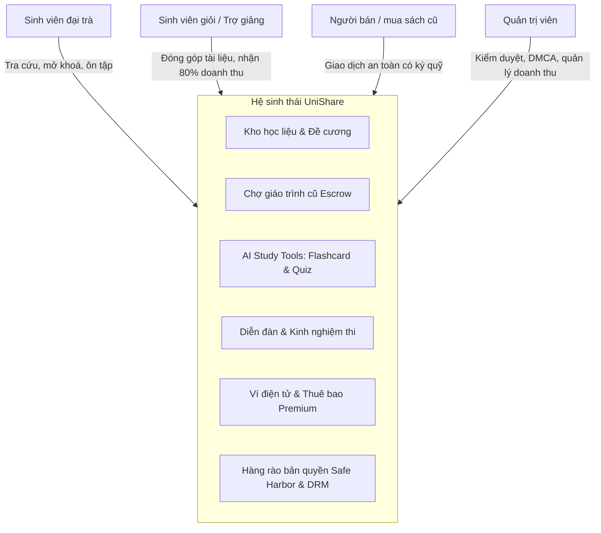
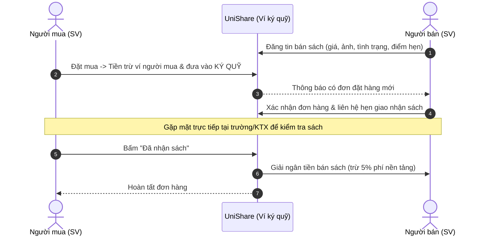
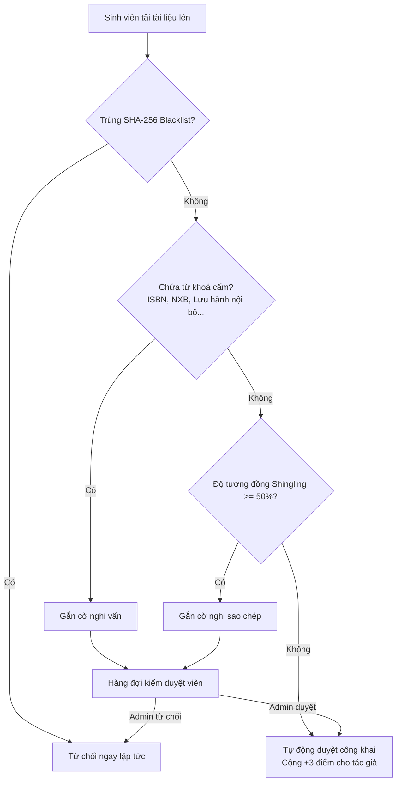

# TÀI LIỆU GIỚI THIỆU CHỨC NĂNG HỆ THỐNG UNISHARE (BÁ KHÍ)

> **UniShare (Bá Khí)** là nền tảng số hoá học liệu sinh viên, kết hợp giữa **Kho chia sẻ tài liệu ôn thi tự biên soạn**, **Công cụ học tập thông minh (Flashcard & Quiz)**, **Chợ trao đổi giáo trình cũ có ký quỹ (Escrow)** và **Diễn đàn học thuật** dành cho sinh viên các trường đại học tại Việt Nam.

---

## 1. TỔNG QUAN NỀN TẢNG

UniShare giải quyết bài toán cốt lõi:
1. **Tìm kiếm đúng trọng tâm:** Thay vì tìm kiếm trên mạng với các tài liệu trôi nổi, UniShare phân loại học liệu chính xác theo **Trường đại học** và **Mã học phần tín chỉ** (`IT3011`, `TOKT1101`, `MI1111`...).
2. **Bản quyền hợp pháp (Content Pivot):** Nền tảng định hướng sinh viên chia sẻ tài liệu phái sinh tự biên soạn (Study Guide, Cheat Sheet, lời giải đề thi công khai, đồ án mẫu, bài giảng video P2P) thay vì tài liệu lậu.
3. **Bảo vệ quyền tác giả (Anti-Piracy):** Đóng dấu chìm định danh động (Dynamic Watermark) trên từng trang PDF, vô hiệu hoá thao tác sao chép/in ấn trái phép.
4. **Học tập chủ động:** Tự động hoá trích xuất kiến thức thành Flashcard lặp lại ngắt quãng (Leitner 5 hộp) và đề trắc nghiệm tự luyện.
5. **Giao dịch sách cũ minh bạch:** Tiền mua sách được giữ ký quỹ, chỉ giải ngân cho người bán khi người mua đã nhận được sách nguyên vẹn.

---

## 2. CÁC PHÂN HỆ CHỨC NĂNG CHÍNH

### 2.1. Phân hệ Kho Học Liệu & Đề Cương Ôn Tập

#### A. Tra cứu & Lọc đa chiều
- **Tìm kiếm theo từ khoá & ngữ cảnh:** Tìm theo tên môn học, chủ đề ôn tập, khái niệm trọng tâm hoặc tên giảng viên/sinh viên biên soạn.
- **Bộ lọc chuẩn hoá:**
  - **Trường đại học:** 12 trường thành viên (HUST, NEU, UET, FTU, UIT, HCMUS, HCMUT, UEH, PTIT, HANU, DAV, TMU...).
  - **Mã học phần:** Hơn 60 học phần đại cương và chuyên ngành có sẵn hoặc tự động gợi ý theo trường.
  - **Loại tài liệu:**
    - *Đề cương / Study Guide*: Tóm tắt kiến thức trọng tâm, sơ đồ phân nhánh.
    - *Cheat Sheet / Công thức*: Bảng tra cứu 1-2 trang công thức tính nhanh.
    - *Lời giải chi tiết đề thi*: Phân tích từng bước, hướng biến đổi và các lỗi sai thường gặp.
    - *Câu hỏi ôn tập / Đề thi cũ*: Bộ câu hỏi tự luyện theo cấu trúc đề thi các năm.
    - *Sơ đồ tư duy (Mindmap)*: Cấu trúc trực quan hoá liên kết kiến thức.
    - *Báo cáo / Đồ án mẫu*: Khung cấu trúc BRD, SRS, tiểu luận nghiên cứu đạt điểm A.
    - *Source code*: Mã nguồn minh hoạ thuật toán, bài tập lớn kèm ghi chú.
    - *Khoá học video P2P*: Video bài giảng ngắn do sinh viên đạt điểm A+ tự quay.
    - *Kinh nghiệm thi*: Mẹo phân bổ thời gian phòng thi, các bẫy đề thi hay gặp.
  - **Hình thức truy cập:** Tài liệu miễn phí (mở bằng điểm thưởng / gói Premium) hoặc tài liệu thương mại (tác giả tự định giá).
  - **Sắp xếp:** Mới cập nhật, Điểm đánh giá cao nhất, Lượt xem nhiều nhất, Giá tăng dần.

#### B. Quy trình Tải lên & Cam kết bản quyền (Upload Pipeline)
- **Hỗ trợ định dạng phong phú:** PDF, DOC/DOCX, PPT/PPTX, file mã nguồn (`.c`, `.cpp`, `.py`, `.java`, `.js`, `.ts`, `.sql`), file nén ZIP/RAR, hình ảnh và video MP4/WEBM (tối đa 50MB).
- **Cam kết bản quyền bắt buộc (Click-wrap Agreement):** Người tải lên bắt buộc phải tích cam kết nội dung do chính mình biên soạn và chịu trách nhiệm pháp lý trước khi bấm đăng. Hệ thống lưu trữ dấu thời gian (timestamp) và địa chỉ IP cam kết.
- **Cơ chế thưởng điểm (Give & Take):** Mỗi tài liệu hợp lệ vượt qua kiểm duyệt, người đăng được cộng ngay **+3 điểm** vào tài khoản.

#### C. Trình đọc bảo mật & Chống thất thoát nội dung (Anti-Piracy Viewer)
- **Vô hiệu hoá trích xuất trái phép:** Trình đọc tắt hoàn toàn thao tác bôi đen sao chép văn bản (`select/copy`), chuột phải (`contextmenu`), kéo thả (`dragstart`), và các phím tắt `Ctrl+P` (in), `Ctrl+S` (lưu), `Ctrl+U` (xem nguồn).
- **Dynamic Watermark (Đóng dấu chìm động):**
  - Trên giao diện đọc web: Nhãn định danh gồm `Email | User ID` của người đang xem di chuyển ngẫu nhiên trên màn hình mỗi 4 giây nhằm ngăn chặn việc chụp ảnh màn hình hoặc quay lén.
  - Trên file PDF: Khi xem hoặc tải về, thư viện xử lý phía máy chủ (`pdf-lib`) nhúng trực tiếp dấu chìm mờ nghiêng 30 độ chứa thông tin người xem lên **toàn bộ các trang** của file.
- **Cơ chế Preview 20%:** Người dùng chưa mở khoá/chưa mua chỉ được đọc 20% nội dung đầu (hoặc 20% số trang đầu của PDF) để đánh giá chất lượng trước khi thanh toán.

#### D. Đánh giá & Phản hồi cộng đồng
- Xếp hạng 1 – 5 sao và nhận xét chi tiết.
- Chỉ người đã có quyền đọc đầy đủ nội dung (đã mua, đã mở khoá hoặc dùng Premium) mới được viết đánh giá, tránh tình trạng spam đánh giá ảo.

---

### 2.2. Phân hệ Chợ Trao Đổi & Mua Bán Giáo Trình Cũ

- **Đăng tin trực quan:** Đăng bán hoặc tặng miễn phí sách/giáo trình cũ; gắn mã môn học, trường, độ mới (Mới 99%, Tốt, Khá, Cũ), ảnh chụp thật, tuỳ chọn "Nhận đổi sách" và địa điểm giao nhận (KTX, sảnh thư viện, cổng trường...).
- **Cơ chế Ví ký quỹ bảo vệ người mua (Escrow System):**
  - Khi đặt mua, số tiền tương ứng được tạm giữ an toàn trong hệ thống ký quỹ của UniShare, tin đăng chuyển sang trạng thái "Đang giao dịch".
  - Người bán không thể nhận tiền ngay, loại bỏ hoàn toàn rủi ro lừa đảo chuyển khoản trước rồi bùng hàng.
  - Người mua có thể huỷ đơn khi người bán chưa xác nhận và nhận lại 100% tiền ký quỹ vào ví.
  - Sau khi kiểm tra sách thực tế, người mua bấm "Đã nhận sách", hệ thống mới giải ngân tiền cho người bán sau khi trừ phí dịch vụ giao dịch **5%** (tối thiểu 2.000đ).

---

### 2.3. Phân hệ Công Cụ Học Tập Thông Minh (Smart Study Tools)

#### A. Flashcard lặp lại ngắt quãng (Leitner System 5 Hộp)
- **Phương pháp Spaced Repetition khoa học:** Mỗi thẻ được phân cấp vào 1 trong 5 hộp ghi nhớ:
  - Hộp 1: Ôn lại sau 1 ngày (thẻ mới / chưa nhớ).
  - Hộp 2: Ôn lại sau 3 ngày.
  - Hộp 3: Ôn lại sau 7 ngày.
  - Hộp 4: Ôn lại sau 14 ngày.
  - Hộp 5: Ôn lại sau 30 ngày (đã ghi nhớ dài hạn).
- **Quy tắc Leitner:** Bấm "Đã nhớ" $\rightarrow$ Thẻ thăng lên hộp kế tiếp; Bấm "Chưa nhớ" $\rightarrow$ Thẻ lập tức quay về Hộp 1 để ôn tập lại.
- **Giao diện học tập tiện dụng:** Lật thẻ mượt mà bằng phím `Space` hoặc chạm màn hình, tự động lọc danh sách các thẻ "Đến hạn ôn hôm nay".

#### B. Tự động sinh Flashcard từ tài liệu (AI / Heuristic Generator)
- Thành viên Premium chỉ cần 1 cú click **"Tạo bộ thẻ Flashcard"** trên trang xem tài liệu.
- Thuật toán phân tích cú pháp tự động quét toàn bộ văn bản và trích xuất các mẫu:
  - `Thuật ngữ: Định nghĩa`
  - `Khái niệm – Nội dung giải thích`
  - `X là Y` / `X được định nghĩa là Y`
- Tạo ngay một bộ thẻ mới sẵn sàng để ôn thi mà không cần gõ tay từng thẻ.

#### C. Đề kiểm tra trắc nghiệm (Quiz Generator 4 đáp án)
- Tự động xáo trộn và lấy ngẫu nhiên các câu hỏi từ bộ Flashcard để tạo đề thi thử trắc nghiệm 4 phương án.
- Thuật toán tự động ghép phương án đúng với 3 phương án gây nhiễu (distractors) từ các thẻ khác trong cùng bộ.
- Chấm điểm tự động tức thì, hiển thị rõ đáp án đúng/sai kèm phần trăm hoàn thành.

---

### 2.4. Phân hệ Diễn Đàn & Kinh Nghiệm Thi

- **Không gian thảo luận ngang hàng (Peer-to-Peer):**
  - Phân loại chủ đề rõ ràng: *Kinh nghiệm thi*, *Hỏi đáp ôn tập*, *Mẹo học tập*, *Trao đổi đề thi cũ*.
  - Gắn thẻ mã môn học và trường đại học để sinh viên cùng lớp/khoá dễ dàng kết nối.
  - Trình soạn thảo hỗ trợ định dạng Markdown, hiển thị khối mã nguồn (code block), trích dẫn và danh sách bài tập.
- **Hệ thống bình luận tương tác:** Nhận thông báo thời gian thực khi có người phản hồi bài viết của mình.

---

### 2.5. Phân hệ Ví Điện Tử, Điểm Thưởng & Thuê Bao Premium

#### A. Ví điện tử nội bộ
- Quản lý số dư tiền mặt phục vụ cho:
  - Mua tài liệu có phí của sinh viên giỏi (chia 80% tác giả / 20% nền tảng).
  - Ký quỹ mua sách giáo trình cũ.
  - Đăng ký gói thành viên Premium.
  - Nhận tiền doanh thu bán tài liệu hoặc bán giáo trình.
- Hỗ trợ mô phỏng nạp tiền qua cổng thanh toán QR: VNPay, Ví MoMo, Chuyển khoản ngân hàng.
- Sao kê minh bạch lịch sử biến động số dư (`transactions`).

#### B. Hệ sinh thái Điểm thưởng (Gamification Points)
- **Tặng 5 điểm** ngay khi mở tài khoản.
- **Cộng 3 điểm** khi đóng góp một tài liệu tự soạn được duyệt.
- Dùng **1 điểm** để mở khoá vĩnh viễn 1 tài liệu miễn phí.

#### C. Gói thuê bao UniShare Premium
| Quyền lợi | Tài khoản Thường | Tài khoản Premium |
|---|:---:|:---:|
| **Xem tài liệu miễn phí** | Tốn 1 điểm / tài liệu | **Không giới hạn** (không tốn điểm) |
| **Số lượng bộ Flashcard** | Tối đa 1 bộ (20 thẻ) | **Không giới hạn** số bộ & số thẻ |
| **Tự sinh Flashcard từ tài liệu** | Không hỗ trợ | **Hỗ trợ toàn bộ tài liệu** |
| **Làm đề trắc nghiệm (Quiz)** | Không hỗ trợ | **Không giới hạn** |
| **Trải nghiệm giao diện** | Có quảng cáo nhà tài trợ | **Ẩn hoàn toàn quảng cáo** |
| **Hỗ trợ tác giả & cộng đồng** | Tiêu chuẩn | Huy hiệu Premium nổi bật |

**Bảng giá các gói Premium:**
- **Gói Tháng:** `49.000đ` (30 ngày) — Thích hợp ôn thi giữa kỳ/cuối kỳ ngắn hạn.
- **Gói Học kỳ (Phổ biến nhất):** `199.000đ` (150 ngày) — Đồng hành trọn vẹn cả kỳ học.
- **Gói Năm:** `349.000đ` (365 ngày) — Tiết kiệm tối đa cho sinh viên năng động.

---

### 2.6. Cơ Chế Bản Quyền Safe Harbor & Kiểm Duyệt Nội Dung

Tuân thủ nghiêm ngặt **Điều 198b Luật Sở hữu trí tuệ sửa đổi 2022** và **Nghị định 17/2023/NĐ-CP** đối với doanh nghiệp cung cấp dịch vụ trung gian (OSP):

#### A. Pipeline kiểm duyệt tự động 3 lớp
1. **Lớp 1 – Quét SHA-256 Hash:** So khớp mã băm tệp với danh sách đen các tệp đã từng bị gỡ do vi phạm $\rightarrow$ Chặn tải lên lại ngay lập tức.
2. **Lớp 2 – Lọc từ khoá bản quyền:** Tự động trích xuất nội dung văn bản (kể cả file PDF và code), quét các dấu hiệu của sách xuất bản hoặc tài liệu nội bộ: *"Lưu hành nội bộ"*, *"Nhà xuất bản"*, *"NXB Giáo dục"*, *"ISBN"*, *"All rights reserved"*, *"Bản quyền thuộc về"*... $\rightarrow$ Gắn cờ (`flagged`) nếu phát hiện.
3. **Lớp 3 – Đo độ tương đồng văn bản (Text Shingling):** Tính toán độ phủ 5-shingles với các tài liệu đã duyệt trên hệ thống $\rightarrow$ Nếu độ trùng lặp vượt ngưỡng 50% sẽ tự động gắn cờ để kiểm duyệt viên kiểm tra hành vi đạo văn.

#### B. Quy trình Notice & Takedown chuẩn mực (Hạn xử lý 72 giờ)
- Mọi tài liệu đều có nút **"Báo cáo vi phạm bản quyền / DMCA"** công khai.
- Biểu mẫu khiếu nại yêu cầu: Họ tên, Email, Vai trò (Giảng viên, Nhà trường, Tác giả gốc, NXB), Bằng chứng sở hữu quyền và Cam kết trung thực.
- Đồng hồ đếm ngược **72 giờ** hiển thị trực quan trong trang Admin:
  - Khi xác nhận vi phạm: Gỡ bỏ tài liệu, tự động cộng **+1 Strike (cảnh cáo)** cho người đăng.
  - Tích chọn đưa SHA-256 của tệp vào Blacklist để vĩnh viễn không ai đăng lại được tệp đó.
  - **Quy tắc 3 Strikes:** Người dùng nhận đủ 3 lần cảnh cáo sẽ bị hệ thống **khoá tài khoản vĩnh viễn**.

---

### 2.7. Phân Hệ Quản Trị Hệ Thống (Admin Dashboard)

Dành riêng cho ban quản trị vận hành nền tảng:
- **Báo cáo Doanh thu & GMV:** Thống kê chi tiết theo từng mô hình (Thuê bao Premium, Hoa hồng bán tài liệu 20%, Phí giao dịch giáo trình 5%, Doanh thu quảng cáo đối tác) và nhật ký bút toán tài chính.
- **Hàng đợi kiểm duyệt (Moderation Queue):** Xem nội dung, mức độ tương đồng và lý do gắn cờ để phê duyệt hoặc từ chối kèm lý do phản hồi cho tác giả.
- **Xử lý khiếu nại bản quyền:** Danh sách các yêu cầu gỡ bỏ kèm trạng thái quá hạn / còn hạn xử lý.
- **Quản trị người dùng:** Tra cứu, khoá/mở khoá tài khoản, quản lý số lần cảnh cáo (strikes) và phân quyền vai trò.
- **Quản lý Quảng cáo đối tác:** Tạo chiến dịch quảng cáo cho các nhà sách, trung tâm ngoại ngữ; theo dõi số lượt hiển thị (Impressions), số lượt click và tỷ lệ chuyển đổi (CTR). Hệ thống tự động ẩn quảng cáo đối với các tài khoản Premium.
- **Quản trị Blacklist:** Thêm/xoá các từ khoá nhạy cảm hoặc mã băm SHA-256 cấm tải lên.
- **Quản lý Danh mục:** Thêm mới các trường đại học và học phần đào tạo.

---

## 3. BẢNG PHÂN QUYỀN TÍNH NĂNG CHI TIẾT

| Tính năng | Khách vãng lai | Sinh viên thường | Thành viên Premium | Tác giả nội dung | Quản trị viên (Admin) |
|---|:---:|:---:|:---:|:---:|:---:|
| **Xem trang chủ, danh bạ trường, học phần** | Có | Có | Có | Có | Có |
| **Tìm kiếm & lọc tài liệu, giáo trình** | Có | Có | Có | Có | Có |
| **Xem trước (Preview) 20% tài liệu** | Có | Có | Có | Có | Có |
| **Gửi báo cáo vi phạm bản quyền (DMCA)** | Có | Có | Có | Có | Có |
| **Mở khoá tài liệu miễn phí** | Không | Bằng điểm (1 điểm) | **Không giới hạn** | Đọc tệp của mình | Toàn quyền |
| **Mua tài liệu trả phí (Marketplace)** | Không | Thanh toán ví | Thanh toán ví | Đọc tệp của mình | Toàn quyền |
| **Tải tệp gốc có dấu chìm PDF** | Không | Khi có quyền xem | Khi có quyền xem | Toàn quyền | Toàn quyền |
| **Tạo bộ thẻ Flashcard thủ công** | Không | Tối đa 1 bộ (20 thẻ) | **Không giới hạn** | Không giới hạn | Không giới hạn |
| **Tự sinh Flashcard AI từ tài liệu** | Không | Không | **Có** | **Có** | **Có** |
| **Làm đề thi trắc nghiệm (Quiz)** | Không | Không | **Có** | **Có** | **Có** |
| **Đăng bán / Tặng giáo trình cũ** | Không | Có | Có | Có | Có |
| **Đặt mua giáo trình qua Ví ký quỹ** | Không | Có | Có | Có | Có |
| **Viết bài & bình luận diễn đàn** | Không | Có | Có | Có | Có |
| **Đăng tài liệu & nhận 80% doanh thu** | Không | Có | Có | Có | Có |
| **Trải nghiệm không quảng cáo** | Không | Không | **Có** | Có (nếu là Premium) | **Có** |
| **Duyệt bài gắn cờ, xử lý DMCA, xem doanh thu**| Không | Không | Không | Không | **Toàn quyền** |

---

## 4. CÔNG NGHỆ & ĐIỂM SÁNG KỸ THUẬT

- **Nền tảng Full-Stack tối ưu:** Xây dựng trên nền tảng **Node.js + Express** và giao diện mẫu **EJS**, đảm bảo tốc độ phản hồi tính bằng mili-giây, khả năng tương thích cao trên mọi trình duyệt.
- **Cơ sở dữ liệu nhúng WebAssembly (sql.js):** Lưu trữ toàn bộ dữ liệu trên SQLite mà không yêu cầu cài đặt máy chủ cơ sở dữ liệu cồng kềnh, dễ dàng sao lưu, di chuyển và triển khai trên các dịch vụ đám mây miễn phí như Render hoặc Docker.
- **Xử lý tài liệu PDF mức byte (`pdf-lib` & `pdf-parse`):**
  - Trích xuất văn bản tự động phục vụ bộ lọc bản quyền.
  - Cắt trang linh hoạt cho bản xem trước 20%.
  - Vẽ văn bản bản quyền vector trực tiếp lên các trang PDF mà không làm vỡ định dạng trang in gốc.
- **Bảo mật giao dịch bằng Transaction:** Mọi thao tác tài chính (nạp tiền, mua tài liệu, tạm giữ ký quỹ, giải ngân, hoàn tiền) đều được bọc trong giao dịch CSDL ACID chặt chẽ, tự động Rollback khi xảy ra lỗi, ngăn chặn hoàn toàn sai lệch số dư.
- **Phong cách giao diện Academic Editorial:** Thiết kế tối giản, sạch sẽ, không màu mè theo kiểu template AI rẻ tiền, tập trung tối đa vào trải nghiệm đọc học liệu và thao tác học tập của sinh viên.

---

## 5. THÔNG TIN TRUY CẬP DÙNG THỬ

| Vai trò | Email đăng nhập | Mật khẩu mặc định | Mục đích trải nghiệm |
|---|---|---|---|
| **Quản trị viên (Admin)** | `admin@unishare.vn` | `admin123` | Xem Dashboard doanh thu, hàng đợi kiểm duyệt, xử lý khiếu nại DMCA, quản lý quảng cáo |
| **Sinh viên Premium** | `an@student.vn` | `123456` | Trải nghiệm xem không giới hạn, tạo Flashcard AI từ tài liệu, làm đề Quiz, ví có sẵn 500.000đ |
| **Sinh viên thường** | `binh@student.vn` | `123456` | Trải nghiệm mở khoá bằng điểm, mua tài liệu trả phí, đặt mua giáo trình ký quỹ |
| **Sinh viên thường 2** | `chi@student.vn` | `123456` | Đăng bài diễn đàn, đăng bán giáo trình, kiểm tra luồng trao đổi sách |
