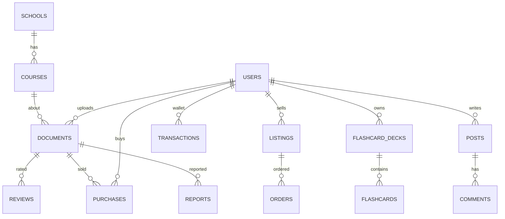
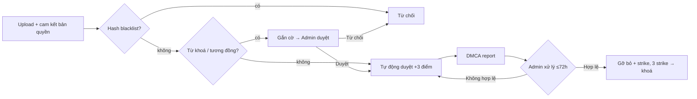

# UniShare – Đặc tả yêu cầu phần mềm (SRS rút gọn)

> Nền tảng chia sẻ tài liệu ôn thi, đề cương, lời giải, kinh nghiệm thi và chợ trao đổi / mua bán giáo trình cũ dành cho sinh viên.
> Phiên bản: 1.0 (MVP chạy được) – Công nghệ: Node.js + Express + EJS + SQLite (sql.js, không cần cài đặt CSDL).

---

## 1. Mục tiêu & phạm vi

| Mục tiêu | Mô tả |
|---|---|
| Chia sẻ tri thức hợp pháp | Sinh viên đăng **nội dung do chính mình biên soạn** (study guide, cheat sheet, mindmap, lời giải, báo cáo/đồ án mẫu, source code, khoá học P2P, kinh nghiệm thi). |
| Tìm kiếm nhanh | Tìm theo **từ khoá, trường, mã môn học**, loại tài liệu, miễn phí / trả phí, sắp xếp theo mới nhất / đánh giá / lượt xem / giá. |
| Chợ giáo trình cũ | Đăng bán / tặng / trao đổi sách, giáo trình cũ; thanh toán qua ví có **ký quỹ (escrow)**, nền tảng thu phí giao dịch. |
| Học tập hiệu quả | Flashcard lặp lại ngắt quãng (Leitner), tự sinh flashcard từ tài liệu, tạo đề trắc nghiệm (Premium). |
| Tuân thủ bản quyền | Click-wrap cam kết bản quyền, kiểm duyệt tự động, quy trình **Notice & Takedown** 72h, cơ chế cảnh cáo (strike) & khoá tài khoản. |
| Doanh thu | Premium (thuê bao), hoa hồng marketplace tài liệu (20%), phí giao dịch giáo trình (5%, tối thiểu 2.000đ), quảng cáo đối tác. |

**Ngoài phạm vi MVP (roadmap):** cổng thanh toán thật (VNPay/MoMo – hiện mô phỏng), OCR ảnh/PDF scan (Tesseract), trích xuất DOCX/PPTX, HLS AES‑128 cho video, AI LLM thật, ứng dụng di động, chat realtime.

## 2. Tác nhân (Actors)

| Tác nhân | Quyền |
|---|---|
| Khách (Guest) | Xem trang chủ, tìm kiếm, xem **preview 20%**, xem chợ giáo trình, diễn đàn, gửi khiếu nại bản quyền (không cần đăng nhập). |
| Sinh viên (User) | Mọi quyền của khách + đăng tài liệu, mua tài liệu, mở khoá bằng điểm, đánh giá, đăng tin bán sách, đặt mua, viết bài diễn đàn, flashcard (giới hạn), ví, mua Premium. |
| Sinh viên Premium | Xem **không giới hạn** tài liệu miễn phí, flashcard không giới hạn, **tự sinh flashcard** từ tài liệu, **Quiz trắc nghiệm**, ẩn quảng cáo. |
| Tác giả / Người bán | Nhận doanh thu (80% giá tài liệu, giá bán sách – phí giao dịch). |
| Quản trị viên (Admin) | Dashboard doanh thu, hàng đợi kiểm duyệt, xử lý khiếu nại bản quyền, quản lý người dùng, quảng cáo, blacklist, trường/môn học. |

## 3. Yêu cầu chức năng

### 3.1 Tài khoản
- FR-01 Đăng ký (email, mật khẩu ≥ 6 ký tự, họ tên, trường, ngành). Tặng **5 điểm** khi đăng ký.
- FR-02 Đăng nhập / đăng xuất; tài khoản bị khoá không đăng nhập được.
- FR-03 Hồ sơ cá nhân, đổi mật khẩu, trang hồ sơ công khai (tài liệu & tin bán của người dùng).
- FR-04 Thông báo trong hệ thống (mua hàng, duyệt tài liệu, khiếu nại…).

### 3.2 Tài liệu học tập
- FR-10 Đăng tài liệu: tiêu đề, mô tả, loại, trường, **mã môn** (tự tạo môn mới nếu chưa có), nội dung soạn trực tiếp (Markdown) và/hoặc file đính kèm (PDF, DOCX, PPTX, TXT, MD, ZIP, ảnh, MP4/WEBM, file code), giá (0 = miễn phí, 5.000đ – 2.000.000đ), cho phép tải file gốc hay không.
- FR-11 **Bắt buộc tích cam kết bản quyền (click-wrap)**; hệ thống lưu thời điểm & IP cam kết.
- FR-12 **Pipeline kiểm duyệt tự động** khi upload:
  1. Tính SHA‑256 file → trùng **hash trong blacklist** ⇒ *Từ chối*.
  2. Trích xuất văn bản (PDF/TXT/MD/code) + tiêu đề, mô tả, nội dung ⇒ so khớp **từ khoá blacklist** (VD: "lưu hành nội bộ", "nhà xuất bản", "ISBN", "all rights reserved") ⇒ *Gắn cờ*.
  3. **So khớp tương đồng** (shingling 5 từ, độ phủ ≥ 50%) với các tài liệu đã duyệt ⇒ *Gắn cờ* (nghi sao chép).
  4. Không vi phạm ⇒ *Tự động duyệt*, cộng **3 điểm** cho tác giả. Tài liệu gắn cờ chỉ hiển thị sau khi admin duyệt thủ công.
- FR-13 Xem tài liệu: trình đọc web **chặn copy / chuột phải / in / Ctrl+S**, **watermark động** (email + ID người xem) chạy ngẫu nhiên trên màn hình.
- FR-14 Quy tắc truy cập:

| Trường hợp | Quyền xem |
|---|---|
| Tác giả, Admin | Toàn bộ |
| Tài liệu trả phí | Preview 20% → mua để xem toàn bộ (Premium không bao gồm tài liệu trả phí) |
| Tài liệu miễn phí + Premium | Toàn bộ |
| Tài liệu miễn phí + thường | Preview 20% → mở khoá bằng **1 điểm** (kiếm điểm bằng cách đăng tài liệu) |

- FR-15 PDF hiển thị qua route được bảo vệ, **đóng dấu chìm động** (email, ID, thời gian) trên từng trang bằng pdf-lib; người chưa có quyền chỉ nhận **20% số trang đầu**.
- FR-16 Tải file gốc chỉ khi có quyền đầy đủ **và** tác giả cho phép; PDF tải về luôn có watermark người mua.
- FR-17 Video khoá học P2P: stream qua route có kiểm tra quyền, chặn nút tải, watermark ID chạy ngẫu nhiên.
- FR-18 Mua tài liệu bằng ví: người mua trả 100%, tác giả nhận 80%, nền tảng thu **20% hoa hồng**.
- FR-19 Đánh giá 1–5 sao + bình luận (chỉ khi đã có quyền xem đầy đủ, mỗi người 1 đánh giá – có thể cập nhật).
- FR-20 Tìm kiếm & lọc: từ khoá, trường, mã môn, loại, giá; phân trang 12 mục.
- FR-21 "Tài liệu của tôi" (trạng thái, lượt xem, doanh thu) và "Thư viện" (đã mua / đã mở khoá).

### 3.3 Chợ giáo trình cũ
- FR-30 Đăng tin: tên sách, tác giả, mã môn, trường, tình trạng, giá (0 = tặng), cho phép trao đổi, khu vực giao dịch, ảnh.
- FR-31 Đặt mua → tiền bị **giữ ký quỹ** từ ví người mua, tin chuyển "Đang giao dịch".
- FR-32 Người bán xác nhận → người mua bấm "Đã nhận sách" → người bán nhận tiền trừ **phí 5% (tối thiểu 2.000đ)**.
- FR-33 Huỷ đơn (người mua khi chờ xác nhận; người bán khi chưa hoàn tất) → hoàn tiền 100%, tin mở bán lại.

### 3.4 Diễn đàn
- FR-40 Bài viết theo chuyên mục (Kinh nghiệm thi, Hỏi đáp ôn tập, Mẹo học tập, Trao đổi đề thi cũ), gắn trường / mã môn; bình luận.

### 3.5 Flashcard & Quiz
- FR-50 Bộ thẻ, thêm/xoá thẻ; người dùng thường tối đa 1 bộ / 20 thẻ, Premium không giới hạn.
- FR-51 Học theo **Leitner 5 hộp** (nhớ → lên hộp, ôn lại sau 1/3/7/14/30 ngày; quên → về hộp 1).
- FR-52 (Premium) **Tự sinh flashcard** từ tài liệu có quyền xem (nhận diện mẫu "Thuật ngữ: định nghĩa", "X là Y", "A – B").
- FR-53 (Premium) **Quiz trắc nghiệm** 4 đáp án sinh từ bộ thẻ (≥ 4 thẻ), chấm điểm tức thì.

### 3.6 Ví, Premium, Doanh thu
- FR-60 Ví điện tử nội bộ: nạp tiền (mô phỏng VNPay/MoMo/Chuyển khoản), lịch sử giao dịch.
- FR-61 Gói Premium: Tháng 49.000đ (30 ngày), Học kỳ 199.000đ (150 ngày), Năm 349.000đ (365 ngày); mua thêm sẽ cộng dồn thời hạn.
- FR-62 Sổ doanh thu nền tảng theo nguồn: `premium`, `commission`, `txn_fee`, `ads`.

### 3.7 Quảng cáo
- FR-70 Admin tạo quảng cáo cho đối tác (nhà sách, trung tâm ngoại ngữ, khoá học, dịch vụ SV), vị trí `home` / `sidebar`, ngân sách (ghi nhận doanh thu ads).
- FR-71 Đếm lượt hiển thị & lượt click (route chuyển hướng `/ads/:id/click`). Premium không thấy quảng cáo.

### 3.8 Bản quyền – Safe Harbor (Điều 198b Luật SHTT 2022, NĐ 17/2023/NĐ-CP)
- FR-80 Trang **Điều khoản & Chính sách bản quyền** công khai.
- FR-81 Nút **"Báo cáo vi phạm bản quyền / DMCA"** ở mọi tài liệu và footer; form gồm: người khiếu nại, email, vai trò (giảng viên/nhà trường/tác giả/NXB), tác phẩm gốc, mô tả, link bằng chứng, cam kết trung thực.
- FR-82 Mỗi khiếu nại có **hạn xử lý 72 giờ**, admin thấy đồng hồ đếm ngược / quá hạn.
- FR-83 Gỡ bỏ (takedown): ẩn tài liệu, +1 strike cho người đăng; **3 strike ⇒ khoá tài khoản**; tuỳ chọn đưa hash file vào blacklist chống đăng lại.
- FR-84 Nền tảng không dùng tài khoản hệ thống để đăng nội dung; dữ liệu demo là nội dung tự soạn mẫu.

## 4. Yêu cầu phi chức năng
- NFR-01 Mật khẩu băm **bcrypt**; session cookie `httpOnly`, `sameSite=lax`.
- NFR-02 File tài liệu lưu ngoài thư mục public, chỉ truy cập qua route kiểm tra quyền.
- NFR-03 Chống XSS: EJS escape mặc định, Markdown được escape trước khi render.
- NFR-04 Giới hạn upload 50MB, whitelist phần mềm mở rộng.
- NFR-05 Mọi thao tác tiền tệ chạy trong **transaction** CSDL (rollback khi lỗi / thiếu số dư).
- NFR-06 Chạy trên Windows/macOS/Linux chỉ với Node.js ≥ 18, không cần cài CSDL.
- NFR-07 Giao diện tiếng Việt, responsive.

## 5. Mô hình dữ liệu (rút gọn)



Bảng phụ: `unlocks`, `revenue`, `ads`, `blacklist`, `notifications`.

## 6. Luồng chính



## 7. Kiến trúc mã nguồn

```
src/
  app.js            Khởi tạo Express, middleware, route
  config.js         Hằng số nghiệp vụ (giá, phí, giới hạn)
  db.js             Lớp truy cập SQLite (sql.js, lưu file data/unishare.sqlite)
  schema.sql        Lược đồ CSDL
  seed.js           Dữ liệu mẫu + tài khoản demo
  middleware/       auth, upload
  services/         access, moderation, wallet, watermark, flashcardGen
  routes/           pages, auth, documents, market, forum, flashcards, account, admin
  utils.js          Định dạng tiền/ngày, Markdown an toàn, preview
views/              Giao diện EJS
public/             CSS, JS phía client
tests/smoke.js      Kiểm thử end-to-end tự động toàn bộ luồng
```
